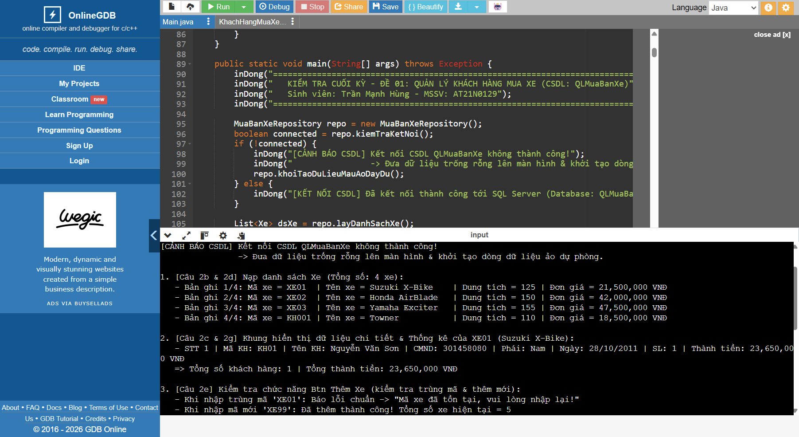
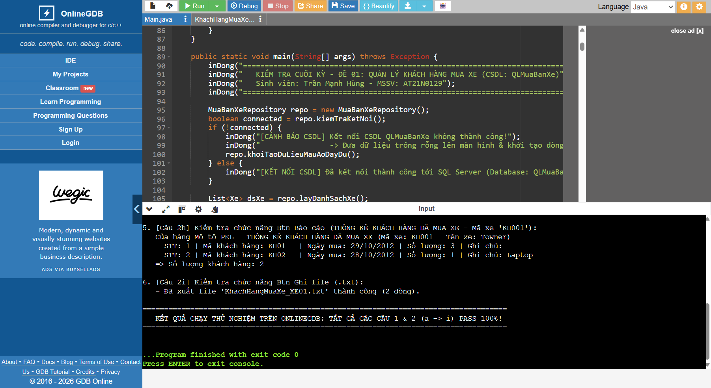
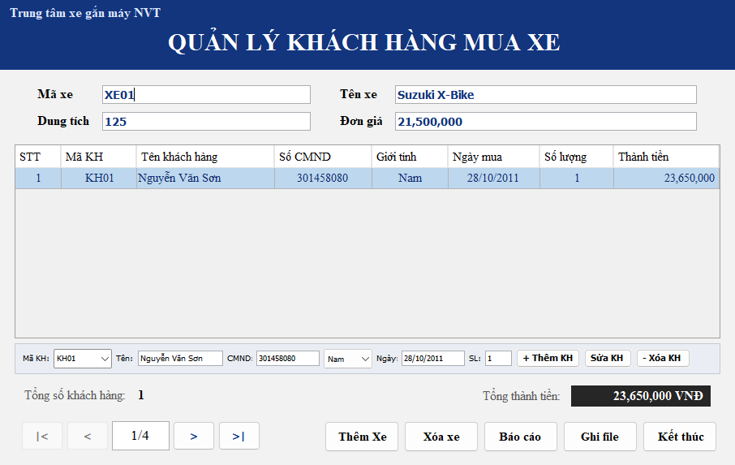
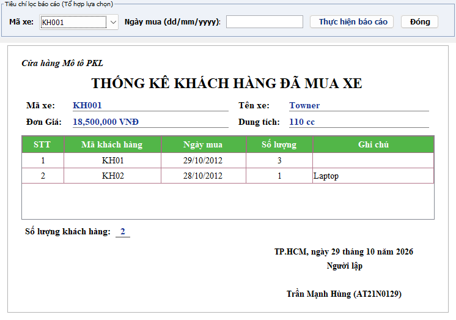
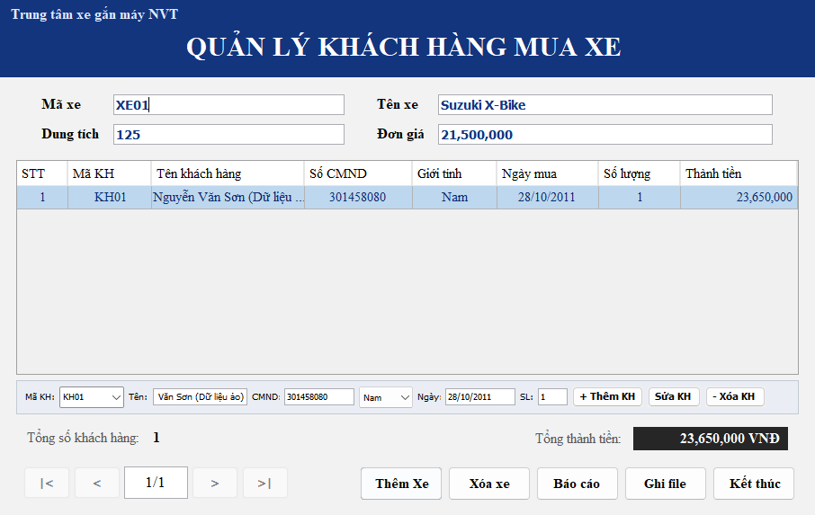

# Hồ Sơ Kiểm Tra Cuối Kỳ Môn Lập Trình Java (KMA) — `QLMuaBanXe`

- **Sinh viên thực hiện:** Trần Mạnh Hùng — **MSSV:** `AT21N0129`
- **Đơn vị:** Khoa An toàn thông tin — Học viện Kỹ thuật Mật mã (KMA)
- **Repository URL:** https://github.com/HayTinHung/KMA-Java-KiemTraCuoiKy-QLMuaBanXe

---

## 📌 Hướng Dẫn Dành Cho Claude Khi Kiểm Tra (Audit Checklist)

Bạn có thể kiểm tra trực tiếp toàn bộ bài làm theo đúng đề thi gốc và quy định của Giảng viên tại các đường dẫn sau trong repo:

### 1. Đề Thi Gốc & Quy Định Nộp Bài Trên Classroom (`01_DeThi_Va_TaiLieuTruong/`)
- **File PDF đề thi cuối kỳ:** [`01_DeThi_Va_TaiLieuTruong/De_Kiem_Tra_Cuoi_Ky/De CK.pdf`](01_DeThi_Va_TaiLieuTruong/De_Kiem_Tra_Cuoi_Ky/De%20CK.pdf)
- **Ảnh chụp 3 trang đề thi gốc:**
  - Trang 1: [`De_CK_Trang_1.png`](01_DeThi_Va_TaiLieuTruong/De_Kiem_Tra_Cuoi_Ky/De_CK_Trang_1.png)
  - Trang 2: [`De_CK_Trang_2.png`](01_DeThi_Va_TaiLieuTruong/De_Kiem_Tra_Cuoi_Ky/De_CK_Trang_2.png)
  - Trang 3: [`De_CK_Trang_3.png`](01_DeThi_Va_TaiLieuTruong/De_Kiem_Tra_Cuoi_Ky/De_CK_Trang_3.png)
- **Ảnh chụp yêu cầu nộp bài của Giảng viên trên Classroom:** [`YeuCau_NopBai_Classroom.png`](01_DeThi_Va_TaiLieuTruong/De_Kiem_Tra_Cuoi_Ky/YeuCau_NopBai_Classroom.png)
  - *Yêu cầu 1:* Nộp 2 tập tin gồm `(Tập tin nén thư mục mã nguồn project, tên: AT21N0129-Trần Mạnh Hùng-QLMuaBanXe.zip)` và `(Tập tin văn bản Word chứa tất cả các lớp cần thiết, lớp hàm main nằm ở trên cùng, tên: AT21N0129-Trần Mạnh Hùng-QLMuaBanXe.doc / .docx)`.
  - *Yêu cầu 2:* Sao chép tất cả nội dung trong tập tin văn bản Word vào trình biên dịch online Java (`https://www.onlinegdb.com/online_java_compiler`) để chạy thử nghiệm.
- **Bộ 7 file PDF Tài liệu giảng dạy chính thức của trường KMA:** [`01_DeThi_Va_TaiLieuTruong/7_PDF_TaiLieu_Cua_Truong_KMA/`](01_DeThi_Va_TaiLieuTruong/7_PDF_TaiLieu_Cua_Truong_KMA/)

---

### 2. Bài Làm Kiểm Tra Cuối Kỳ (`02_BaiLam_KiemTraCuoiKy_QLMuaBanXe/`)

1. **Hai tập tin chính thức nộp lên Classroom (`2_TapTin_Nop_Classroom/`):**
   - [`AT21N0129-Trần Mạnh Hùng-QLMuaBanXe.zip`](02_BaiLam_KiemTraCuoiKy_QLMuaBanXe/2_TapTin_Nop_Classroom/AT21N0129-Tr%E1%BA%A7n%20M%E1%BA%A1nh%20H%C3%B9ng-QLMuaBanXe.zip)
   - [`AT21N0129-Trần Mạnh Hùng-QLMuaBanXe.doc`](02_BaiLam_KiemTraCuoiKy_QLMuaBanXe/2_TapTin_Nop_Classroom/AT21N0129-Tr%E1%BA%A7n%20M%E1%BA%A1nh%20H%C3%B9ng-QLMuaBanXe.doc) & [`AT21N0129-Trần Mạnh Hùng-QLMuaBanXe.docx`](02_BaiLam_KiemTraCuoiKy_QLMuaBanXe/2_TapTin_Nop_Classroom/AT21N0129-Tr%E1%BA%A7n%20M%E1%BA%A1nh%20H%C3%B9ng-QLMuaBanXe.docx) *(100% nội dung trong file Word là mã nguồn Java hợp lệ với `public class Main` ở trên cùng — nhấn `Ctrl+A` -> `Ctrl+C` dán thẳng vào OnlineGDB biên dịch chạy ngay 0 lỗi)*.
2. **File đơn tệp hợp nhất (`Main.java`) chạy trên OnlineGDB:**
   - [`02_BaiLam_KiemTraCuoiKy_QLMuaBanXe/Main.java`](02_BaiLam_KiemTraCuoiKy_QLMuaBanXe/Main.java)
3. **Kịch bản CSDL SQL Server & File Backup (`Câu 1a & 1b`):**
   - [`02_BaiLam_KiemTraCuoiKy_QLMuaBanXe/QLMuaBanXe.sql`](02_BaiLam_KiemTraCuoiKy_QLMuaBanXe/QLMuaBanXe.sql)
   - [`02_BaiLam_KiemTraCuoiKy_QLMuaBanXe/QLMuaBanXe.bak`](02_BaiLam_KiemTraCuoiKy_QLMuaBanXe/QLMuaBanXe.bak)
4. **Mã nguồn tách rời từng lớp trong `src/`:**
   - [`src/KhachHang.java`](02_BaiLam_KiemTraCuoiKy_QLMuaBanXe/src/KhachHang.java) — Thực thể bảng `Khach_Hang`
   - [`src/Xe.java`](02_BaiLam_KiemTraCuoiKy_QLMuaBanXe/src/Xe.java) — Thực thể bảng `Xe` (đóng gói hệ số `TY_LE_THANH_TIEN = 1.10`)
   - [`src/ChiTietMuaXe.java`](02_BaiLam_KiemTraCuoiKy_QLMuaBanXe/src/ChiTietMuaXe.java) — Thực thể chi tiết mua xe (`Thành tiền = Đơn giá * Số lượng * 1.10`, khớp hình đề bài `21,500,000 * 1 = 23,650,000`)
   - [`src/MuaBanXeRepository.java`](02_BaiLam_KiemTraCuoiKy_QLMuaBanXe/src/MuaBanXeRepository.java) — Kết nối CSDL SQL Server `QLMuaBanXe`, kiểm tra kết nối lúc khởi chạy & tự động tạo dòng dữ liệu ảo khi mất kết nối
   - [`src/BaoCaoMuaXeDialog.java`](02_BaiLam_KiemTraCuoiKy_QLMuaBanXe/src/BaoCaoMuaXeDialog.java) — Cửa sổ Báo cáo thống kê `THỐNG KÊ KHÁCH HÀNG ĐÃ MUA XE` (Câu 2h)
   - [`src/QuanLyMuaBanXeGUI.java`](02_BaiLam_KiemTraCuoiKy_QLMuaBanXe/src/QuanLyMuaBanXeGUI.java) — Cửa sổ chính `QUẢN LÝ KHÁCH HÀNG MUA XE` (Câu 2a -> 2i, xác nhận `Yes/No` trên mọi nút lệnh)
   - [`src/DeCuoiKyAutoGradingSuite.java`](02_BaiLam_KiemTraCuoiKy_QLMuaBanXe/src/DeCuoiKyAutoGradingSuite.java) — Bộ kiểm thử tự động 27/27 Test Cases (PASS 100%)

---

### 3. Hình Ảnh Minh Chứng Thực Tế (GUI & OnlineGDB)

#### A. Chạy thử nghiệm trên `https://www.onlinegdb.com/online_java_compiler` (Phần đầu & Phần cuối Console — 0 lỗi font, Exit code 0)

#### B. Giao diện chính & Cửa sổ Báo cáo thống kê trên Desktop

